<p align="center">
  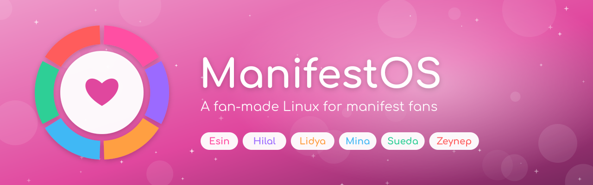
</p>

<p align="center">
  <b>An unofficial, fan-made Linux for fans of manifest.</b><br>
  Pick your bias and your whole desktop turns her color.
</p>

<p align="center">
  <a href="https://github.com/manifest-linux/manifestos/releases/latest"></a>
  <a href="https://github.com/manifest-linux/manifestos/actions/workflows/build-iso.yml"></a>
  
  
</p>

<p align="center">
  <a href="https://manifest-linux.github.io/manifestos/try/"><b>Try it in your browser</b></a> · <a href="https://manifest-linux.github.io/manifestos/">Website</a> · <a href="https://github.com/manifest-linux/manifestos/releases/latest">Download the ISO</a>
</p>

## On stage

<p align="center">
  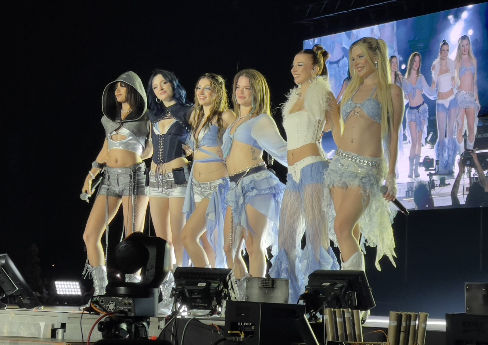<br>
  <sub>Bursa concert, 5 June 2026. Photo by ZethRod, <a href="https://commons.wikimedia.org/wiki/File:Manifest_Bursa_050626.jpg">CC0</a>.</sub>
</p>

<table>
  <tr>
    <td width="33%">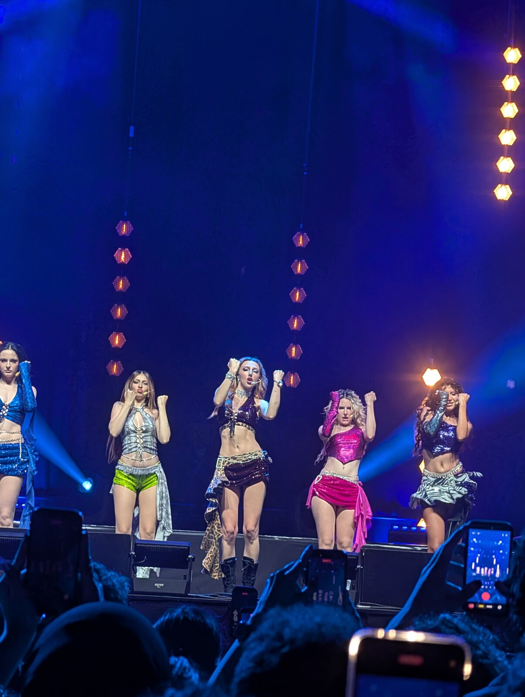<br><sub>Photo by Shadow4dark, <a href="https://commons.wikimedia.org/wiki/File:Manifest_at_concert.jpg">CC0</a>.</sub></td>
    <td width="33%">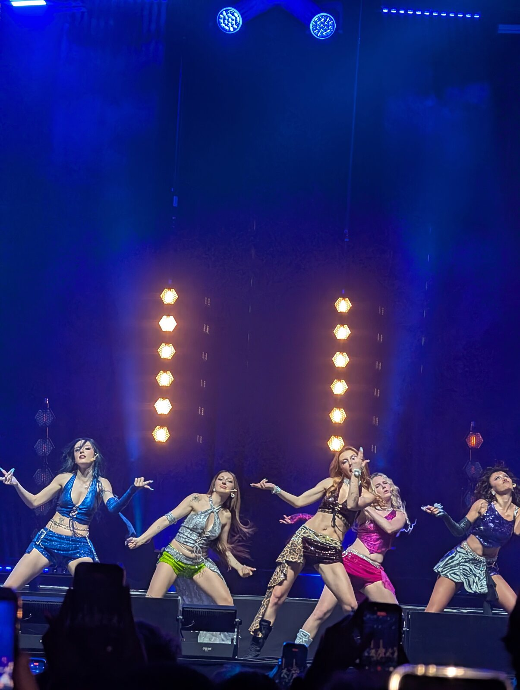<br><sub>Photo by Shadow4dark, <a href="https://commons.wikimedia.org/wiki/File:Manifest_at_concert_2.jpg">CC0</a>.</sub></td>
    <td width="33%">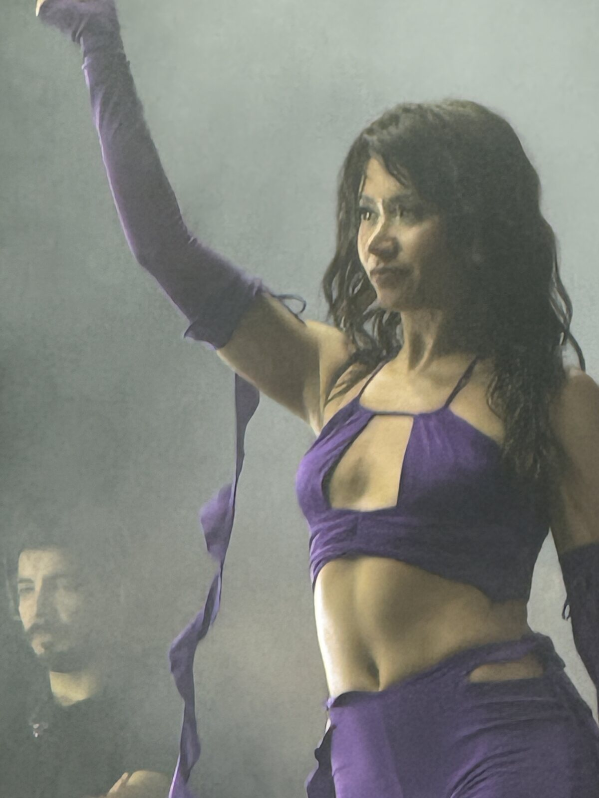<br><sub>Hilal in Antalya. Photo by 07, <a href="https://commons.wikimedia.org/wiki/File:Hilal_Yelek%C3%A7i.jpg">CC BY-SA 4.0</a>.</sub></td>
  </tr>
</table>

## See it running

<p align="center">
  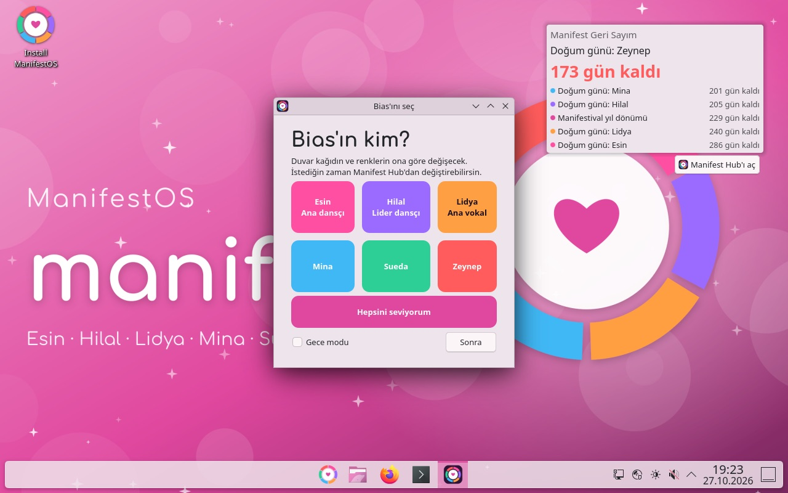
</p>

<table>
  <tr>
    <td width="50%">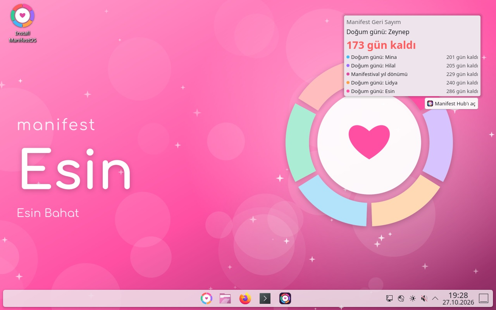<br><sub>Picked Esin as bias, so the wallpaper and colors follow her.</sub></td>
    <td width="50%">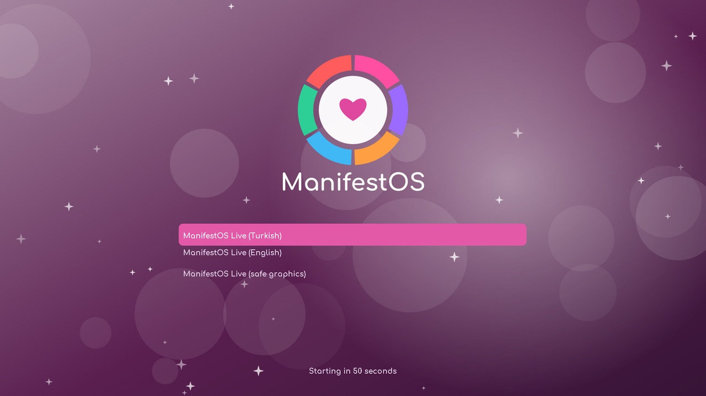<br><sub>The boot menu lets you start in Turkish or English.</sub></td>
  </tr>
</table>

## Meet the members

<table>
  <tr>
    <td align="center" width="33%">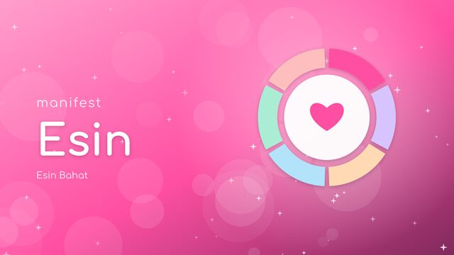<br><b>Esin Bahat</b><br><sub>Main dancer · Birthday 9 August</sub></td>
    <td align="center" width="33%">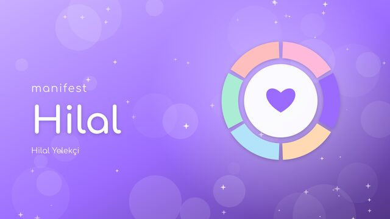<br><b>Hilal Yelekçi</b><br><sub>Lead dancer · Birthday 20 May</sub></td>
    <td align="center" width="33%">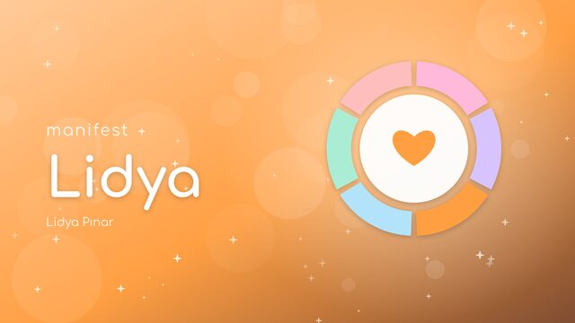<br><b>Lidya Pınar</b><br><sub>Lead vocalist · Birthday 24 June</sub></td>
  </tr>
  <tr>
    <td align="center">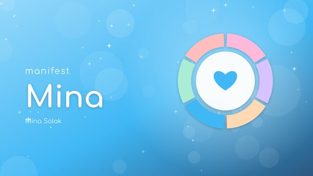<br><b>Mina Solak</b><br><sub>Birthday 16 May</sub></td>
    <td align="center">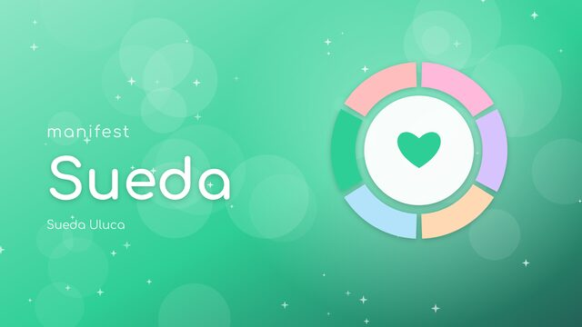<br><b>Sueda Uluca</b><br><sub>Birthday 22 August</sub></td>
    <td align="center">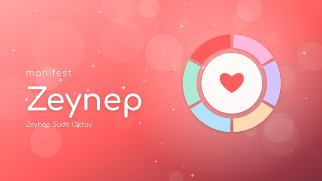<br><b>Zeynep Sude Oktay</b><br><sub>Birthday 18 April</sub></td>
  </tr>
</table>

Every member gets her own color, wallpaper and confetti birthday wallpaper. The colors are ManifestOS picks, not official ones.

Follow manifest on [YouTube](https://www.youtube.com/@m6nifestgirls), [Instagram](https://www.instagram.com/m6nifestgirls/) and [TikTok](https://www.tiktok.com/@m6nifestgirls).

## What's inside

- **Bias picker.** Choose your favorite member on first login and the wallpaper, accent color and theme switch to match her.
- **Manifest Hub.** Member profiles, the latest videos from the official channel, the discography, a countdown list and every link in one app.
- **Birthday surprises.** On a member's birthday you get a notification and a confetti wallpaper made just for her.
- **Countdown widget.** A desktop widget counts down to the next birthday, anniversary or concert you add.
- **Feels familiar.** A centered taskbar and start menu, so anyone coming from Windows feels at home.
- **Little extras.** Themed boot screen, login screen and installer slides, a fan art lock screen, night mode and a `manifest` terminal command.

<p align="center">
  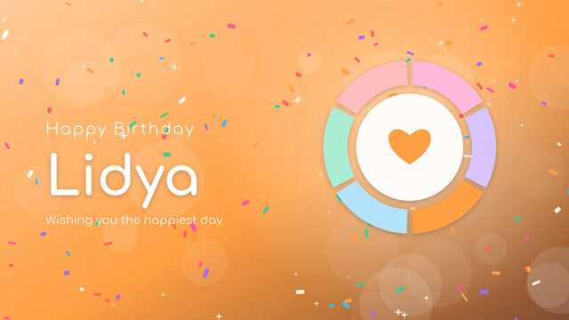
  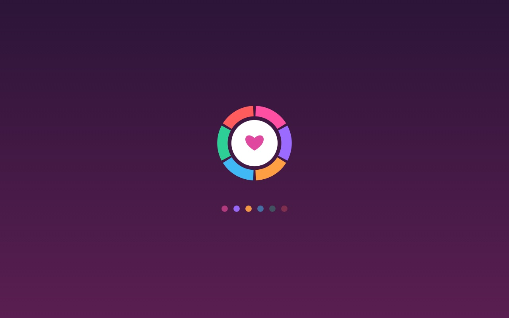
</p>

## Install

1. Download the latest ISO from [Releases](https://github.com/manifest-linux/manifestos/releases/latest).
2. Write it to a USB stick of at least 4 GB with balenaEtcher, Rufus (DD mode) or Ventoy.
3. Turn off Secure Boot in your BIOS settings and boot from the USB stick.
4. Pick Turkish or English in the boot menu and try everything live.
5. Double-click **Install ManifestOS** on the desktop when you are ready.

## Logo and brand files

| File | Use |
| --- | --- |
| [`docs/brand/logo.svg`](docs/brand/logo.svg) | Logo, any size |
| [`docs/brand/logo-white.svg`](docs/brand/logo-white.svg) | Logo for dark backgrounds |
| [`docs/brand/logo-1024.png`](docs/brand/logo-1024.png) | Logo as PNG (also 256 and 512) |
| [`docs/brand/avatar.png`](docs/brand/avatar.png) | Profile picture |
| [`docs/brand/banner.png`](docs/brand/banner.png) | Header banner |
| [`docs/brand/social-preview.png`](docs/brand/social-preview.png) | Link preview image |

The six ring segments stand for the six members, with one heart in the middle.

## Build locally

You need Docker. On Apple Silicon the build runs under amd64 emulation and takes longer.

```bash
./build.sh
```

The ISO and its checksum land in `out/`. `MANIFESTOS_VERSION`, `MANIFESTOS_HOME_URL` and `MANIFESTOS_MIRROR` are passed through to the build if set.

Unit tests for the shared Python code:

```bash
python3 -m unittest discover -s tests -v
```

The brand images are rendered with `art/make_brand.py docs/brand` and need `rsvg-convert` and the Comfortaa font.

## How it fits together

- `mkiso.sh` runs inside a Debian container: it bootstraps trixie, installs `config/packages.txt`, installs the three ManifestOS packages, runs `config/customize-chroot.sh` and builds a hybrid BIOS/UEFI ISO with `grub-mkrescue`.
- `packages/` holds the source trees of `manifestos-base` (os-release diversion, GRUB defaults, live session tweak), `manifestos-artwork` (themes, splash, installer branding) and `manifestos-apps` (Manifest Hub, bias picker, `manifest` command, reminders, Plasma widget). `packages/build-debs.sh` turns them into `.deb` files.
- `data/members.json` is the single source for member names, birthdays, colors and the discography. `data/i18n/tr.json` holds the Turkish strings.
- Calamares (Debian settings) installs the system. Its bootloader step installs `grub-efi` or `grub-pc` with apt, so the ISO carries a small apt repository under `pool/` and `dists/` with those packages to make offline installs work.
- `docs/` is the GitHub Pages site.

## Disclaimer

ManifestOS is an unofficial fan project. It is not affiliated with manifest, Hypers New Media or their partners. No music, official photos or logos are included; all artwork is generated by the scripts in `art/`. The concert photos are fan photos from Wikimedia Commons under free licenses, listed in [docs/photos/CREDITS.md](docs/photos/CREDITS.md).
